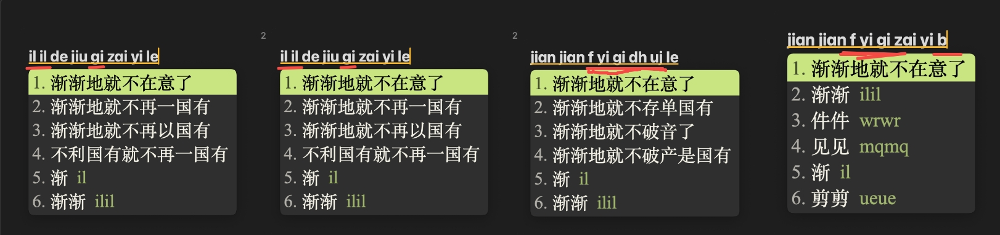

# egret-rime（白鹭五笔·拼音流）

一句话里可以随便换着打五笔和拼音的 Rime 输入方案。

五笔的简码、全码、键名字都还是老样子，长句和拼音歧义交给一个词级语言模型去组。
适合已经会五笔、又不想为长句背码的人；Linux 上用 fcitx5，macOS 上用 Squirrel。

```
qktnqnr                  → 我吃饭          （纯五笔短码序列）
jintiandetianqizenmeyang → 今天的天气怎么样   （纯拼音）
trwuchifan               → 我们吃饭        （五笔词 + 拼音混着打）
```

<p align="center">
  
</p>

## 特色

**一句话里混打。** 上面第三个例子就是重点：`trwu` 是五笔的「我们」，
`chifan` 是拼音，中间不用切模式、也不用按分隔符。方案会自动判断整串是哪种读法
（判定只影响候选排序，不会把你的输入切成几段）。

**五笔手感保留。** 25 个键名字用四连击打，首候选永远是键名字本身：
`kkkk` 出「口」，`dddd` 出「大」，`tttt` 出「禾」。一/二/三级简码、全码、词组显式码
都是 86 标准，重码时按权重排，简码该出什么就出什么。

**长句靠语言模型。** 引擎侧用万象的词级 gram（400MB，octagram 直接读），
不用打补丁、也不用改名成 `.gram` 之外的东西。词库分三档，默认档约 6.3 万词。

**长句页尾留一个字和一个词。** 这是为「首字打错」准备的：打长句时每页最后两项
一个是单字、一个是词，按数字键选它只上屏开头那部分，剩下的输入继续留在组字区。
比如 `womenzaiyiqi` 打出「我们在一起」，但你想打的是「我们在一起过」以外的东西，
就可以先选页尾的「我」把开头一个字数下来，再接着打。

**候选旁边带五笔编码。** 每个候选注释里是它的五笔码，认码和查错都方便。

**用户词典是纯文本。** 三个 user_dict 都落在用户目录下的 `*.user.dict.txt`，
可以直接看、直接改，也可以跟着 git 走。造词按 86 规则自动编码。

**三个方案可选。** `egret_wubi_py` 是混流主方案，另有纯五笔 `egret_wubi` 和纯全拼
`egret_py`。F4 菜单里能切，三个方案共用同一套词库。

简繁切换、emoji、以词定字（C-h / C-l）都有，按键和开关见下。

## 安装

需要机器上已经有 Rime 前端：Linux 的 fcitx5，或者 macOS 的 Squirrel。

```bash
cd ~/repos && git clone --depth 1 https://github.com/jixiuf/egret-rime.git && cd egret-rime
make deploy      # 把方案文件装到输入法用户目录
make reload      # 重建 build，然后重启输入法
```

`make deploy` 在 Linux 上默认装到 `~/.local/share/fcitx5/rime`，macOS 上默认装到
`~/Library/Rime`。用 ibus 或者想装到别处就指定目录：

```bash
make deploy TARGET=~/.config/ibus/rime/
make reload TARGET=~/.config/ibus/rime/
```

文件是用软链装过去的，以后 `git pull` 完执行 `make deploy && make reload` 即可生效。
如果目标目录里原来是实体文件（以前用拷贝方式装过），`make deploy` 会先把它们改名成
`*.bak-<时间戳>` 再建链，想回滚就把备份 `mv` 回来。

第一次安装时脚本会做三件事：缺 `user.yaml` / `default.custom.yaml` 就补一份；
把默认方案设成本方案（你已有的其它方案列表不会被动）；缺语言模型就提示下载。

语言模型单独说一句：它不在仓库里，约 400MB：

```bash
make gram-lm      # 断点续传，已有就跳过；装完 make deploy 会自动软链过去
```

来源是 [RIME-LMDG](https://github.com/amzxyz/RIME-LMDG) 的
`wanxiang-lts-zh-hans.gram`。不装也能用，但长句会明显变差。

装完随便打几个字自查：

```
e                        → 有
jintiandetianqizenmeyang → 今天的天气怎么样
kkkk                     → 口
```

## 无网 / 离线机器

开发机上打个自包含的运行时包，拷到目标机执行脚本就行。包里不含 400MB 的语言模型。

```bash
make bundle                      # 产出 dist/egret-rime-runtime-<日期>.tar.gz

# 目标机上
tar xzf egret-rime-runtime-*.tar.gz && cd egret-rime-runtime-*
bash install.sh                  # 默认装到 ~/Library/Rime 或 ~/.local/share/fcitx5/rime
bash install.sh --link ~/Library/Rime   # 用软链装，改包即生效
bash install.sh --download-lm    # 顺便把语言模型下下来
```

安装前会先把要覆盖的文件备份到 `<目标>/.egret-backup-<时间戳>/`。装完在输入法菜单里
点一次「重新部署」。


## 换词库档位

词库有三档，改的是两个 wrapper 的 `import_tables`：

```bash
make tier TIER=core    # 约 2 万词，最小
make tier TIER=base    # 约 6.3 万词（默认）
make tier TIER=full    # 约 78 万词，最全
make tiers             # 只重新生成三档文件，不动当前档位
```

换完记得 `make deploy && make reload`。

## 常见问题

**长句不准。** 先确认语言模型在不在：`ls ~/Library/Rime/wanxiang-lts-zh-hans.gram`
（Linux 换成 fcitx5 目录）。缺就 `make gram-lm`。

**我想保留自己原来的方案。** `default.custom.yaml` 里用的是追加写法
（`schema_list/+:`），只把本方案加进你的列表，不会删掉 luna_pinyin、仓颉这些。
首次装完的默认方案是本方案，F4 里随时能换，换了以后不会被覆盖。

**打长句时页尾那个字/词不想要。** 页尾两项只在长句（首候选四字以上的整句）时出现，
短码、全码、词组那几屏不会这样排。

**想彻底卸掉。** 把用户目录里指向本仓库的软链删掉，再把 `.bak-<时间戳>` 或
`.egret-backup-<时间戳>` 里的东西挪回来，重启输入法。

## 数据来源

方案的词库和语言模型不是凭空来的，主要来自这几处，都在文档里写了出处：

- [RIME-LMDG](https://github.com/amzxyz/RIME-LMDG)／万象词库与词级语言模型
- [rime-wubi](https://github.com/rime/rime-wubi) 等 86 五笔字词表
- [白霜拼音](https://github.com/gaboolic/rime-frost) 等拼音字表
- [librime](https://github.com/rime/librime) 与其 octagram / lua 插件
- 自有的 epub 与文稿语料（只用来统计词频、挖四字词和整句，原始文件不进仓库）

再分发前请确认各上游项目的许可。

## 开发者

架构、词库生成、部署机制、门禁命令都挪到 [docs/DEVELOPMENT.md](docs/DEVELOPMENT.md) 了。
接手会话先看 [docs/HANDOFF.md](docs/HANDOFF.md)，历史决策和踩坑在
[docs/PROGRESS.md](docs/PROGRESS.md)，Rime 引擎/词库/gram 的知识库索引在
[docs/README.md](docs/README.md)。
